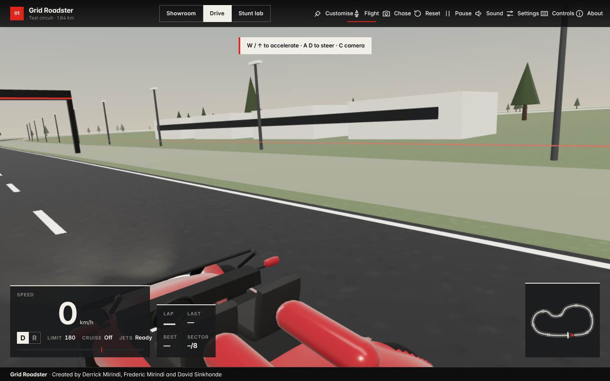

# Grid Roadster

**Created by Derrick Mirindi, Frederic Mirindi and David Sinkhonde**

An original browser driving application with three modes:

- **Showroom** — inspect an open-top roadster and customise its paint, finish and wheels.
- **Drive** — drive it around a 1.84 km test circuit with a speed limiter, cruise
  control, four cameras, a minimap and checkpoint-validated lap timing.
- **Stunt lab** — scrub through a half-pipe climb and a jet-powered flight for
  13 different bodies carrying the same fictional fan-and-air-jet rig, with a
  live free-body force diagram, cutaway, flight path and three cameras.

**Play:** https://derrickmirindi.github.io/roadster-drive/



## What it is (and isn't)

- **Arcade-style handling.** The vehicle model is a lightweight arcade
  simulation written for this project. It is not a validated vehicle-dynamics
  model. See [How the simulation works](#how-the-simulation-works).
- **Original assets.** The car ("GR-1", a sculpted long-bonnet two-seater generated from lofted cross-sections), circuit, textures, icons and sounds are
  generated in code. No third-party car model, branding or audio is used.
- **Inspired by, not copied from,** the public interactive demo at
  `roadster.pplx.app`. That page is a scripted physics replay; this project is a
  free-driving application with its own design and code.

## Features

| Area | Details |
| --- | --- |
| Modes | **Showroom** (orbit, zoom, appearance, lighting, keys preview), **Drive** and **Stunt lab** |
| Stunt lab | Scrubbable replay (play/pause, ¼×–2×, chapters, Ramp / Flight trials), 13 vehicles, live free-body diagram and in-scene force arrows, wall-hold / ceiling-hold / lift-off verdicts, live height / vertical speed / roll, cutaway of the rig, flight path, Follow / Wide / Orbit cameras |
| Driving | Throttle, brake, steering that calms down at speed, handbrake slides, explicit Drive/Reverse gear selection |
| Jet flight | `F` / **Flight** / **JET** fires the lift jets while driving: ~8 m jump with an optional barrel roll, lands on the road at the same speed; tanks refill in 5 s |
| Speed | Live speed from the simulated velocity, km/h or mph, adjustable maximum-speed limit, cruise control |
| Cameras | Orbit (showroom), chase, hood, overhead — blended transitions, no ground clipping |
| Track | Closed loop with straights and corners, lane markings, kerbs, barriers, run-off, start gantry |
| Recovery | Barrier collisions, reset to track (R), automatic recovery when stuck or out of bounds |
| Customise | 8 paint swatches + colour picker, gloss / metallic / matte, separate wheel colour, headlights, reset |
| Lighting | Day / night; headlights are real spot lights that light the road |
| Laps | 7 ordered checkpoints + start/finish, lap / last / best, best lap stored locally with reset |
| Settings | Graphics quality (auto/low/medium/high), camera shake, speed FOV, reduced motion, touch controls, audio |
| Audio | Synthesised engine, tyre and impact sounds (Web Audio), starts only after interaction, volume + mute |
| Mobile | Large multi-touch steering, gas, brake, gear and handbrake buttons |
| Access | Keyboard-operable menus, visible focus, reduced-motion support, WebGL-unavailable screen |

## Controls

| Key | Action |
| --- | --- |
| `W` / `↑` | Throttle (moves in the selected gear) |
| `S` / `↓` | Brake (stops the car; never reverses it) |
| `A` / `←`, `D` / `→` | Steer |
| `G` | Toggle Drive / Reverse (only below 2 km/h) |
| `Space` | Handbrake |
| `K` | Cruise control on/off · `[` `]` adjust target |
| `C` | Camera: chase → hood → overhead |
| `R` | Reset car onto the track |
| `P` / `Esc` | Pause / resume |
| `F` | Jet flight (lift-off, optional barrel roll, landing) |
| `L` | Headlights · `U` units · `M` mute · `?` controls guide |

Stunt lab: `Space` play/pause, `←` `→` step 0.5 s, `Home` start, `C` camera,
`R` restart. Drag to orbit, scroll or pinch to zoom.

Touch: ◀ ▶ steer (bottom left); **Gas**, **Brake**, **D/R** and **HB** (bottom
right). Steering and throttle can be held together. Camera, Reset and Pause are
in the top bar. Showroom: drag to orbit, pinch or scroll to zoom.

Driving keys are ignored while a form field has focus or a dialog is open, and
every control is released when the window loses focus, the tab is hidden, or a
touch is cancelled.

## Run locally

Requirements: Node.js 20 or newer.

```bash
npm install          # TypeScript compiler + Three.js type definitions (dev only)
npm run build        # compiles src/ to dist/js and copies static files to dist/
npm test             # 30 unit tests: driving, track, laps, jet flight and Stunt lab
npm run preview      # serves dist/ at http://localhost:4173/
```

The `dist/` folder is a complete static site. Host it anywhere (GitHub Pages,
Netlify, any web server). Three.js and the Inter font are vendored under
`public/`, so the built site makes no requests to third-party servers.

End-to-end browser checks (optional, needs Playwright and Chromium):

```bash
npm install --no-save playwright && npx playwright install chromium
npm run preview &    # in another terminal
npm run test:e2e     # writes docs/test-results.json and docs/screenshots/
```

## How the simulation works

- **World scale:** 1 unit = 1 metre; time in seconds; speeds in m/s internally.
- **Fixed timestep:** physics runs at 120 Hz through an accumulator, so handling
  is the same at 30, 60 or 144 fps (verified by tests). Up to 0.25 s of
  simulation is run per frame; on extremely slow devices the game slows down
  rather than skipping through walls.
- **Longitudinal:** tapering engine force (≈ 8.5 m/s² from rest, 270 km/h cap),
  13 m/s² braking, rolling resistance and quadratic drag for gradual coasting.
  The user speed limit acts as a governor; lowering it below the current speed
  eases the car down at 2.5 m/s² instead of snapping.
- **Steering:** kinematic bicycle model (2.55 m wheelbase). Wheel angle shrinks
  with speed, and yaw is capped by a 13 m/s² lateral-acceleration budget, so
  steering is calmer at high speed.
- **Grip:** sideways velocity decays exponentially; the handbrake and grass
  reduce grip so the car can slide.
- **Cruise:** proportional controller with limited throttle (gentle approach);
  disengages on brake, handbrake, barrier contact or leaving gear D.
- **Collisions:** barrier walls 17 m either side of the centre line push the car
  back and absorb most of the impact.

## How the Stunt lab works

An illustrative teaching model, not data about any real vehicle. Every body
carries the same 350 kg rig: extractor fans giving at most 39.2 kN of suction
(twice the 2,000 kg reference weight) and lift jets giving 53.3 kN.

- **Ramp trial:** an 8 m-radius half-pipe from the ground to an inverted
  ceiling. The tyres try to follow a reference speed programme; tyre force is
  limited to μ·N (μ = 1), and the vehicle leaves the surface if the contact
  force would have to pull (N < 0). Gravity, suction, contact and friction are
  the forces that produce the motion (unit-tested force balance).
- **Flight trial:** run-in at 14 m/s, a 0.6 s lift burn, then a 0.5 s roll
  couple calibrated so the reference Roadster rolls exactly once. Lighter bodies
  fly higher and over-rotate; heavier ones cannot lift off and hit the parked
  cars. Nothing is retimed per vehicle.
- Both trials are integrated at 240 Hz and stored as 60 Hz samples, so the
  timeline can be scrubbed both ways. Static verdicts: wall hold μ·S ≥ m·g,
  ceiling hold S ≥ m·g, lift-off T > m·g.

## Project layout

```
index.html            app shell, dialogs, credits
public/styles.css     Swiss-grid interface styles
public/vendor/three/  Three.js r185 (MIT) — vendored
public/fonts/         Inter variable font (OFL-1.1) — vendored
src/                  TypeScript source
  physics.ts          arcade vehicle model + fixed stepper (no Three.js)
  track-path.ts       circuit spline and nearest-point queries (no Three.js)
  world-rules.ts      surfaces, barriers, recovery, reset (no Three.js)
  laps.ts             ordered-checkpoint lap timer (no Three.js)
  car-model.ts        procedural GR-1 roadster
  environment.ts      circuit meshes, scenery, sky, lights, day/night
  cameras.ts          orbit / chase / hood / overhead rig
  input.ts            keyboard + multi-touch with stuck-input protection
  audio.ts            Web Audio synthesis
  minimap.ts          canvas minimap
  flight.ts           jet flight while driving (no Three.js)
  stunt-sim.ts        Stunt lab physics, vehicles, verdicts, timeline (no Three.js)
  stunt-vehicles.ts   13 procedural vehicle bodies and the shared rig
  stunt-lab.ts        Stunt lab scene, cameras, arrows, path, timeline and panel
  settings.ts         persisted settings and best lap
  app.ts, main.ts     application controller, boot, WebGL checks
tests/                unit tests and end-to-end browser checks
docs/                 design notes, test results, screenshots
```

## Licences

Code: MIT (see `LICENSE`). Third-party components and their licences are listed
in [THIRD_PARTY_LICENSES.md](THIRD_PARTY_LICENSES.md).

## Known limitations

See [docs/TESTING.md](docs/TESTING.md#known-limitations).

---

Created by Derrick Mirindi, Frederic Mirindi and David Sinkhonde
